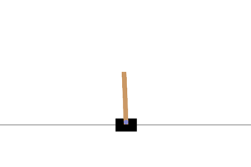
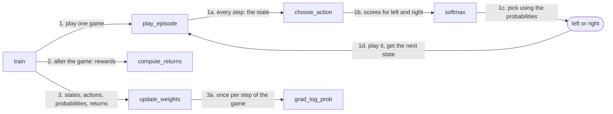
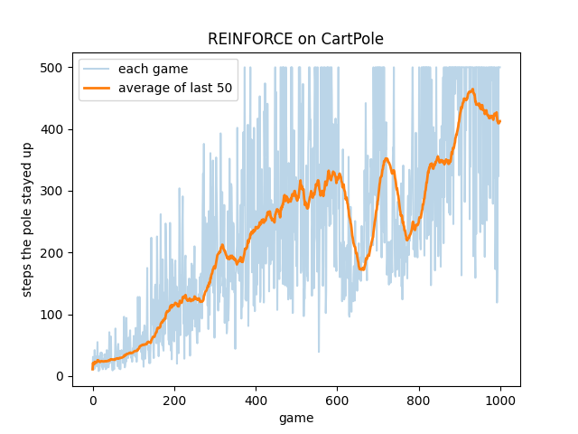
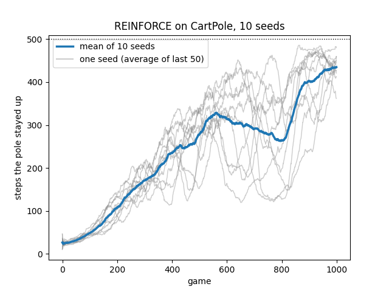

# REINFORCE on CartPole

<p align="center"></p>

## Problem

In Gymnasium's CartPole-v1, a pole is hinged to a cart that moves along a track. At each step the agent pushes the cart either left or right. It sees four numbers, called the state: (1) cart position, (2) cart velocity, (3) pole angle and (4) pole angular velocity.

The agent receives a reward of 1 for every step the pole stays up. A game ends when the pole tilts more than 12°, when the cart leaves the track, or after 500 steps, so the best possible score is 500. The agent is never told which push was correct. The only feedback is how long the game lasted.

## Approach

Reinforcement learning learns from rewards alone, without examples of correct behavior. It works like training a dog to sit: the dog is never told what "sit" means, but it gets a treat when it sits and gradually does it more often.

REINFORCE applies this idea directly. The agent plays a full game with its current policy. Afterward, actions that were followed by a lot of reward are made more likely, and actions followed by little reward are made less likely. This takes four pieces:

1. **Policy:** turns a state into a probability for each action.
2. **Return:** measures how much reward followed each action.
3. **Gradient:** gives the direction to change the policy's weights so that a particular action becomes more likely.
4. **Update:** combines the returns and gradients into one change to the weights.

## Method

### 1. Policy

The policy has 8 weights: 4 for left and 4 for right, one for each state number. Each action's score is its 4 weights multiplied by the 4 state numbers and added up. Softmax then turns the two scores into probabilities that add up to 1.

The action is picked at random using these probabilities rather than always taking the more likely one. This keeps both actions in play, so the agent keeps discovering which one works better. Learning consists of adjusting the weights so that the probabilities favor good actions.

### 2. Return

Every step earns the same reward of 1, so an action's own reward says nothing about whether it was good. Instead, each action is judged by the total reward that came after it, called its return. An action followed by 300 more steps was probably better than one followed by 2.

Rewards further in the future count for less. Each step of distance multiplies a reward's credit by a discount factor slightly below 1. In a five-step game with a discount factor of 0.9, each row of the table shows how much credit one step receives for each later reward:

<div align="center">

| Step | Reward 0 | Reward 1 | Reward 2 | Reward 3 | Reward 4 | Return |
|---|---|---|---|---|---|---|
| 0 | 1 | 0.9 | 0.81 | 0.73 | 0.66 | 4.10 |
| 1 | | 1 | 0.9 | 0.81 | 0.73 | 3.44 |
| 2 | | | 1 | 0.9 | 0.81 | 2.71 |
| 3 | | | | 1 | 0.9 | 1.90 |
| 4 | | | | | 1 | 1.00 |

</div>

The last reward gives step 4 full credit, step 3 a credit of 0.9, and step 0 only 0.66. Discounting matters in CartPole because a push at step 3 has almost nothing to do with whether the pole is still up at step 400. Without it, every early action would be credited with the rest of the game, and the signal would be very noisy. This implementation uses a discount factor of 0.99.

Each row of the table equals the row below it multiplied by the discount factor, plus that step's own reward. This lets all returns be computed in a single pass, working backward from the end of the game.

Early steps always have larger returns because more of the game remains after them. The steps just before the pole falls have the smallest returns, which is the signal the update needs.

### 3. Gradient

For each step, the gradient gives the direction to change the weights so that the chosen action becomes more likely in that state. It does not depend on whether the action was good. The return decides that in the Update section.

Think of the 8 weights as knobs. The gradient finds which way to turn each knob to make the action the agent actually took more likely in that state. The return then decides whether to turn them that way or the opposite way.

### 4. Update

After a game there is a return and a gradient for every step. Each gradient is scaled by its step's return, the results are added up over the whole game, and the weights take one small step in that direction. The learning rate sets the size of that step. In CartPole every return is positive, so every action would be made more likely, even bad ones. To fix this, the returns are first normalized.

### 5. Training

Training repeats three steps once per game: play a game with the current weights, compute the returns, and update the weights. The next game uses the updated weights.

<div align="center">

| Setting | Value |
|---|---|
| Games | 1000 |
| Discount factor | 0.99 |
| Learning rate | 0.01 |
| Starting weights | small random numbers near 0 |
| Random seed | 0 (seeds 0–9 for the comparison across seeds) |

</div>

## Code structure



**1. Play one game.** `train` hands the current weights to `play_episode`, which plays a whole game, called an episode. At every step, `play_episode` gives the current state to `choose_action`, which computes a score for left and for right. `softmax` turns those scores into probabilities, and left or right is picked at random using them. `play_episode` plays that action in the simulator, gets the next state and repeats until the pole falls, the cart leaves the track or 500 steps pass. The weights stay fixed for the whole game.

**2. Score the game.** After the game ends, `train` gives the rewards to `compute_returns`, which works out each step's return, the discounted reward that came after it.

**3. Learn from the game.** `train` gives the states, actions, probabilities and returns to `update_weights`, which goes back through the finished game and calls `grad_log_prob` once for each step. Each gradient is scaled by its step's return, the results are added up, and the weights change once. `train` then starts the next game with the new weights.

## Results

### One run (seed 0)

<p align="center"></p>

### Ten runs (seeds 0–9)

<p align="center"></p>

<div align="center">

| Seed | Final 50-game average | Best 50-game average | Games reaching 500 |
|---|---|---|---|
| 0 | 413 | 465 | 144 |
| 1 | 450 | 450 | 149 |
| 2 | 480 | 483 | 305 |
| 3 | 426 | 471 | 185 |
| 4 | 362 | 434 | 65 |
| 5 | 460 | 486 | 219 |
| 6 | 433 | 465 | 164 |
| 7 | 460 | 460 | 218 |
| 8 | 447 | 475 | 205 |
| 9 | 421 | 454 | 84 |

</div>

Every seed learned to balance the pole, with a final 50-game average of 435 across seeds. Only 3 of the 10 seeds reached 475, the usual threshold for calling CartPole-v1 solved.

## How to run

```bash
python3 -m venv .venv
source .venv/bin/activate
pip install -r requirements.txt
```

One training run of 1000 games with seed 0, saved to `training.png`:

```bash
python train.py
```

10 training runs in parallel with seeds 0–9, saved to `seeds.png`:

```bash
python seeds.py
```
