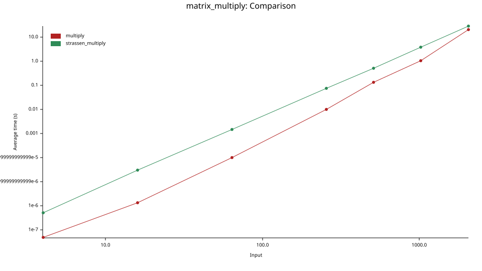

# Dynamic Programming

## Strassen

Matrices can be multiplied with either regular multiplication, which is O(n^3), or Strassen's algorithm. Strassen splits each matrix into quadrants and only does 7 recursive multiplications instead of 8, which makes it O(n^2.81).

The benchmark uses Criterion to time both on random matrices of size 4, 16, 64, 256, 512, 1024, and 2048. Both axes are on a log scale, so the steeper a line is, the faster its time grows as the matrices get bigger.

Strassen did not outperform regular multiplication for any of the sizes Criterion tested. But Strassen's time grows more slowly, so as the graph shows, the two lines will eventually cross over. A good hybrid algorithm would use regular multiplication below the crossover point, which is probably at around a size of 2048, and then Strassen for very large matrices. I didn't run this locally because it would've taken a long time to test, but for very large matrices, Strassen is superior.



To run the unit tests:

```sh
cargo test -p dynamic-programming
```

To run the benchmarks (the 1024 and 2048 sizes take around 10 minutes):

```sh
cargo bench -p dynamic-programming
```

## Genome Sequence

The alignment file implements the Needleman-Wunsch algorithm, scoring +1 for a match, -1 for a mismatch, and -2 for a gap. I ran it on the genome snippet against the test sequence from the Salmonella genome.

The score was **114**. Out of 374 columns, 250 matched (67%) and there were 12 gaps.

```
snippet TGGCGACAACCGTAGCGGAATATTTTCGCGACCAGGGAAAACGGGTCGTGCTT-TTTATC
        |||| || ||  |||| |||| |||||||||  | ||||| || ||||| |||  ||  |
test    TGGCCACCACGATAGCAGAATTTTTTCGCGATAATGGAAAGCGAGTCGT-CTTGCTTGCC

snippet GATTCCATGACCCGTTATGCGCGTGCTTTGCGAGACGTGGCACTGGCGTCGGGAGAGCGT
        || ||  |||| ||||||||  | ||    || ||  | || |||||  | ||||||
test    GACTCACTGACGCGTTATGCCAGGGCCGCACGGGAAATCGCTCTGGCCGCCGGAGAGACC

snippet CCGGCTCGTCGAGGTTATCCCGCC-TCCGTATTCGATAATTTGCCCCG-CTTGCTGGAAC
         ||| |  | |||  ||| |||||   ||||||   |   ||||| || |||  | ||||
test    GCGGTTTCTGGAGAATAT-CCGCCAGGCGTATTTAGTGCATTGCCACGACTT-TTAGAAC

snippet GCCCAGGGGCGACCAG-CGAGGGAAGCATTACTGCCTTTTATACGGTACTGCTGGAAAGC
        |  | |||      ||   | || || ||||| || ||||||||||||||| ||||| ||
test    GTAC-GGGAATGGGAGAAAAAGGCAGTATTACCGCATTTTATACGGTACTGGTGGAAGGC

snippet GAGGAAGAGGCGGACCCGATGGCGGATGAAATTCGCTCTATCCTTGACGGTCA-CCTGTA
        || ||   |   || ||| ||||||||||| | || ||  | ||||| || ||   ||||
test    GATGATATGAATGAGCCGTTGGCGGATGAAGTCCGTTCACTGCTTGATGGACATATTGTA

snippet TCTGAGCAGAAAGCTGGCCGGGCAGGGACATTACCCGGCAATCGATGTACT-GAAAAGCG
         ||   | ||  ||| || | |  ||| ||||| || || || || ||  | | || ||
test    -CTATCCCGACGGCTTGCAGAGAGGGGGCATTATCCTGCCATTGACGTGTTGGCAACGC-

snippet TAAGCCGCGTTTTT
        | ||||||||||||
test    TCAGCCGCGTTTTT
```

This is close to the alignment from the assignment, which had 65% identities.
