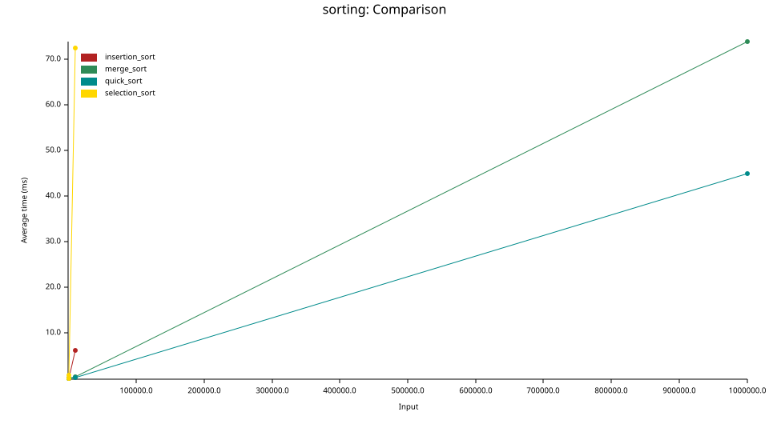

# Sorting Algorithms

## Implemented Algorithms

| Algorithm      | Best       | Average    | Worst      | Extra space |
| -------------- | ---------- | ---------- | ---------- | ----------- |
| Selection sort | O(n^2)      | O(n^2)      | O(n^2)      | O(1)        |
| Insertion sort | O(n)       | O(n^2)      | O(n^2)      | O(1)        |
| Quick sort     | O(n log n) | O(n log n) | O(n^2)      | O(log n)    |
| Merge sort     | O(n log n) | O(n log n) | O(n log n) | O(n)        |

### Selection Sort

Selection sort is the simplest sort here. It sorts the array from the beginning: it finds the lowest element and puts it in the first spot, then finds the next lowest element and puts it in the second spot, and so on. Finding each next-lowest element means iterating through the entire rest of the array, so there are two nested loops and the time complexity is always O(n^2), even if the array is already sorted. That makes it a poor general-purpose sort, and it isn't really used in practice. Its one strength is that it makes at most n - 1 swaps, which is memory efficient.

### Insertion Sort

Insertion sort is similar to selection sort in that it still sorts from left to right. But instead of searching for the lowest item, it just takes the next item and puts it in the correct spot. So instead of iterating through the entire rest of the array, you take the next element and walk it back through the already-sorted part of the array, stopping as soon as you find where it's supposed to go. It's still O(n^2) on average, but if the array is already mostly sorted, each element barely moves and it gets close to O(n).

### Quick Sort

Quick sort is a recursive sorting algorithm that splits the array using a partition. It picks a pivot like the last element and splits the array into a side that is lower than the pivot and a side that is greater than it, with the pivot in its final spot in between. Then it recursively keeps splitting each side until it gets down to arrays of size one. Because every element is already on the correct side of every pivot, once the pieces are that small the whole array is sorted. On average this is O(n log n), but if the pivots split the array badly like on an already-sorted, reverse-sorted, it degrades to O(n^2).

### Merge Sort

Merge sort is similar to quick sort in that it's recursive. The difference is when the sorting happens. With quick sort, the sorting happens in place on the way down, as each partition moves elements to the correct side of the pivot. Merge sort just splits the array in half over and over until it gets to arrays of size one, without sorting anything. The sorting happens on the way back up, when each pair of halves is merged back together in sorted order. The split is always exactly in half, so it's O(n log n) in every case, but merging needs an extra temporary array.

## Criterion Benchmarking

[Criterion](https://bheisler.github.io/criterion.rs/book/) is a benchmarking library for Rust that times how long it takes for code to run. Instead of timing something once, it runs many samples of many iterations each and reports a confidence interval for the time.

In [`benches/sorting.rs`](benches/sorting.rs), we generate a random vector for multiple different sizes, and run every sort on it. Criterion handles the timing itself and creates graphs that are useful for comparing how long each algorithm takes.

The benchmark also works as a unit test. Before timing anything, it runs each sort on every input size, checks that the output is actually sorted.

Run it with:

```sh
cargo bench
```

This also generates an HTML report at `target/criterion/report/index.html`, which you can open in a browser to see more detail on each benchmark.

## Results

Each sort was run on random vectors of 10, 100, 1,000, 10,000, and 1,000,000 elements. Selection sort and insertion sort stop at 10,000. Because they're O(n^2), a single run at 1,000,000 would take too long.

### Time vs. Input Size



This chart shows the difference between O(n^2) and O(n log n). Selection sort's line shoots almost straight up at the far left: sorting 10,000 elements takes it about as long as merge sort takes to sort 1,000,000. Insertion sort climbs steeply too, just not as fast. The chart is stretched out to fit 1,000,000, so all the smaller sizes are squeezed together near zero, and quick sort's and merge sort's lines are really just one segment from 10,000 to 1,000,000.


At 1,000,000 elements, quick sort beats merge sort. Both are O(n log n), so the difference comes from the extra work merge sort does: every merge copies elements into a temporary array and then back. Quick sort just swaps elements in place. Merge sort's advantage is that it's always O(n log n). Quick sort can degrade to O(n^2) bad cases that this benchmark didn't test for.
